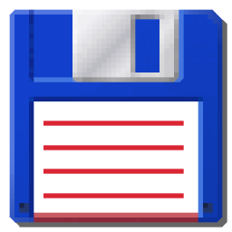

# ClassicCommander

**The orthodox, keyboard-first dual-pane file manager for macOS.**

ClassicCommander brings the speed, muscle-memory shortcuts, and deep file manipulation tools of Total Commander to macOS. Built in pure native Swift and AppKit with zero external dependencies, it gives engineers, administrators, and power users a responsive twin-panel workspace engineered for deterministic, high-throughput file management.

<p align="center">
  
</p>

<p align="center">
  
  
  
  
  
</p>

---

## Why ClassicCommander?

Default desktop file managers force continuous context switching between mouse navigation, competing file-transfer dialogues, and fragmented external utilities.

ClassicCommander restores the proven orthodox file manager model:
* **Two Symmetrical Panels**: Keep your source and target directories side-by-side with independent navigation, tab histories, and custom sort orders.
* **100% Keyboard Operability**: Complete every file triage, selection, comparison, or transfer without lifting your hands from the keyboard.
* **Integrated Power Tooling**: Eliminate third-party bloat with built-in batch renaming, directory reconciliation, side-by-side diffing, and multi-modal file viewing.
* **True Native Footprint**: Zero Electron, zero webviews, and zero runtime dependencies. Launches instantaneously and processes 20,000+ file folders smoothly.

---

## Key Capabilities

### Symmetrical Dual-Pane Workspace
Maintains dedicated Source and Target contexts separated by an adjustable, auto-centering split divider. Features independent folder tabs (`⌃T`, `⌃W`, `⌃Tab`), volume quick-selectors, breadcrumb navigation, and disk capacity meters per panel.

### Canonical Norton Commander Navigation
Executes standard function keys and navigation conventions: `Tab` to switch panels, `F3` View, `F4` Edit, `F5` Copy, `F6` Move/Rename, `F7` New Folder, `F8` Delete to Trash (`⇧F8` Permanent Delete), and `Space` for inline directory size calculation.

### Persistent Wildcard Selection Engine
Select, deselect, or invert files matching complex glob patterns (`+` select, `-` deselect, `*` invert) across multiple extensions (e.g. `*.swift; *.md`). Restore previous selection sets instantly with `Select → Restore Selection`.

### Live Multi-Rename Tool (`⌃M`)
Batch renames thousands of files using dynamic token masks (`[N]` name, `[E]` extension, `[C]` zero-padded counter, `[YMD]` date, `[hms]` time), case transformations, and regular expressions with capture groups. Provides real-time collision detection and two-step collision-safe Undo.

### Directory Synchronization (`Sync Dirs`)
Compares dual folder hierarchies recursively by size, timestamp, or byte-for-byte content. Highlights differences with directional sync markers (`->`, `<-`, `!=`, `==`) and supports one-way asymmetric mirroring.

### Visual Content Diff (`Compare by Content`)
Renders synchronized side-by-side text comparisons with line-by-line and character-level difference highlighting. Streams binary comparisons for large multi-gigabyte files with constant memory overhead.

### Deep Search (`⌥F7`) with "Feed to Listbox"
Recursively filters directories by name mask, containing text, size bounds, and modification age. The "Feed to Listbox" feature populates search results into a live virtual panel, allowing batch copy, move, delete, or rename across disparate directories.

### Internal Multi-Modal Viewer (Lister — `F3`)
Inspects files instantly via memory-mapped buffers. Switch seamlessly between formatted text with word wrap (`1`), raw hexadecimal/ASCII stride view (`2`), and embedded macOS Quick Look previews (`3`) for images, media, and documents.

### Built-in Remote Protocols (FTP, FTPS, SFTP)
Connects directly to remote servers with TLS certificate validation, SSH key pair integration, master password encryption via macOS Keychain, and background queue management.

---

## How It Works

```text
1. Navigate      →  Drive directories independently in Left and Right panels using Arrow keys, Enter, and Backspace.
2. Target        →  Switch active focus instantly with Tab; the opposite panel automatically acts as the target.
3. Select        →  Mark files with Space / Insert, or expand selections using '+' with wildcard masks.
4. Execute       →  Trigger operations (F5 Copy, F6 Move, ⌃M Rename, Sync) with non-blocking progress and collision safety.
5. Inspect       →  Preview contents with F3 Lister or launch diff comparisons with zero startup delay.
```

---

## What Makes It Different

| Capability | Standard macOS Finder | ClassicCommander |
|---|---|---|
| **Layout Paradigm** | Single-window or disparate tabs | Symmetrical dual-panel Source/Target architecture |
| **Keyboard Control** | Primarily mouse and trackpad driven | Complete orthodox keyboard control (`Tab`, `F3`–`F8`, `Insert`) |
| **Batch Renaming** | Basic sequential number appending | Advanced token masks (`[N]`, `[E]`, `[C]`, `[YMD]`), regex, collision warnings, and full Undo |
| **Directory Compare** | Not available natively | Recursive visual directory comparison and asymmetric synchronization |
| **File Viewing** | Spacebar Quick Look overlay | Dedicated Lister window with Text, Hex offset, and Quick Look integration |
| **Search Integration** | Spotlight window results | Deep recursive search with "Feed to Listbox" virtual workspace |
| **Resource Footprint** | System service integrations | Pure native AppKit application with zero external runtime dependencies |

---

## Supported Workflows & Use Cases

* **Software Development**: Inspect git repository diffs, batch rename asset pipelines with regex masks, and search codebases for matching text across subfolders.
* **System Administration**: Navigate mounted server volumes, verify file integrity via SHA-256 and MD5 checksums, and synchronize directory trees across local and remote destinations.
* **Media & Asset Management**: Group select assets by wildcard extensions, calculate folder disk consumption instantly with `Space`, and organize thousands of files with zero-padded counters.
* **Remote Maintenance**: Browse, upload, and download files over secure SFTP and FTPS connections with background transfer queues.

---

## Confirmed Integrations

* **Local File Systems**: Full APFS and HFS+ support, including APFS Copy-on-Write cloning, directory change watching via `FSEvents`, and extended attribute preservation.
* **Remote Protocols**: Built-in FTP, FTPS (explicit TLS), and SFTP (SSH File Transfer Protocol).
* **macOS Services**: Integration with macOS Quick Look preview rendering, system Trash (`F8`), and macOS Keychain for credential storage.
* **Terminal Launching**: Launch user-configured terminal emulators (Terminal, iTerm2) directly at the active panel's path (`⌃⇧T`).

---

## Quick Start

### Build & Run Locally

ClassicCommander requires macOS 12.0 or later and Xcode command-line tools.

```bash
# Clone the repository
git clone https://github.com/your-username/ClassicCommander.git
cd ClassicCommander

# Compile and launch the application
make run
```

### Keyboard Shortcuts Cheatsheet

| Shortcut | Action |
|---|---|
| `Tab` | Switch active panel (Source ↔ Target) |
| `F3` | View focused file in Lister (Text / Hex / Quick Look) |
| `F4` | Open focused file in external editor |
| `F5` | Copy selected files to target panel |
| `F6` | Move or rename selected files to target panel |
| `F7` | Create new directory |
| `F8` / `Del` | Move selected files to Trash |
| `⇧F8` | Delete files permanently |
| `Space` / `Insert` | Toggle file mark / calculate directory size |
| `+` / `-` | Select / Deselect by wildcard mask (e.g. `*.swift; *.h`) |
| `*` | Invert current panel selection |
| `⌃M` | Open Multi-Rename Tool |
| `⌥F7` | Open Find Files search dialog |
| `⌃D` | Open directory hotlist bookmarks |
| `⌃T` / `⌃W` | Open new tab / Close active tab |

---

## Engineering Quality

ClassicCommander is developed with strict adherence to native systems engineering principles:

* **Native Test Suite**: Comprehensive automated test harness with **155 passing unit tests** covering file operations, directory watching, transfer queues, multi-rename parsing, and security regressions.
* **Zero Dependencies**: Pure Swift utilizing macOS system frameworks (`AppKit`, `CoreServices`, `CryptoKit`, `Security`).
* **Continuous Performance Profiling**: Performance-monitored core pathways with precomputed sort keys, single-pass directory listing, and streaming binary comparisons.

To run the automated test suite:
```bash
make test
```

To build a standalone release `.app` bundle:
```bash
make build
```

To package a styled distribution disk image (`.dmg`):
```bash
make dmg
```

---

## License

This project is licensed under the **GNU General Public License v2.0** — see the [LICENSE](LICENSE) file for details.
